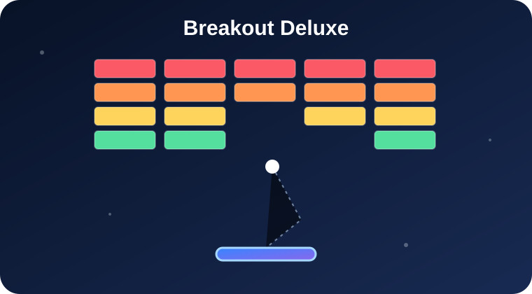

  

  
  

<h1 align="center">🧱 Breakout Deluxe</h1>

  Barevná arkádová hra pro <strong>Scriptable</strong> s rozbíjením kostek a ovládáním pálky prstem.

  

  
  

## Co aplikace umí

**Breakout Deluxe** přináší klasickou arkádu na iPhone. Odrážíš míček pálkou, rozbíjíš barevné kostky a postupuješ dalšími úrovněmi.

## Co hra nabízí

- 🧱 Barevné řady kostek a postup do dalších úrovní.
- 👆 Dotykové ovládání pálky tažením prstu.
- ❤️ Tři životy, bodování a uložený osobní rekord.
- 🎯 Tři obtížnosti: lehká, normální a těžká.
- 🎨 Motivy Vesmír, Oceán a Neon.
- 🔊 Volitelné zvuky, pauza a možnost začít novou hru.
- 🔄 Kontrola nové verze při spuštění i ručně v nastavení.

  

## Jak začít

1. Nainstaluj **Breakout Deluxe** do Scriptable a spusť hru.
2. Klepni na **Spustit hru**, případně na herní plochu, a odpal míček.
3. Tažením prstu doleva a doprava ovládej pálku.
4. Rozbij všechny kostky, získávej body a pokus se překonat rekord.

**Příklad:** Na lehkou obtížnost si vyzkoušíš ovládání; na těžkou musíš s užší pálkou reagovat rychleji.

## Ovládání a obtížnost

Pálka se pohybuje pod míčkem. Na vyšší obtížnosti je menší a hra rychlejší. Tlačítkem **Pauza** můžeš partii zastavit.

## Aktualizace

Při spuštění proběhne automatická kontrola nové verze. V ⚙️ Nastavení vidíš číslo verze, stav kontroly a tlačítko **Zkontrolovat aktualizace**. Nová verze se nabídne k instalaci po dalším spuštění; před přepsáním skriptu se vytvoří záloha. Bez internetu hra funguje dál.

## Dobré vědět

Hru lze hrát offline; připojení je potřeba pouze pro kontrolu a stažení aktualizací. Rekord i nastavení se ukládají lokálně. Jde o samostatnou hru v Scriptable, ne o widget.

**Instalace:** Soubor [Breakout Deluxe.scriptable](./Breakout%20Deluxe.scriptable) otevři v Scriptable. Pokud jej iOS zobrazí pouze jako text, stáhni [JavaScript](./Breakout%20Deluxe.js) a ulož ho do **iCloud Drive → Scriptable**.

## Původ a poděkování

Vlastní implementace inspirovaná klasickou hrou Breakout a ukázkami her na [CodeGuppy](https://codeguppy.com/games/).

## Odkazy

  
  

## Podpora

  

   
  Naskenuj QR kód nebo klikni na tlačítko.

