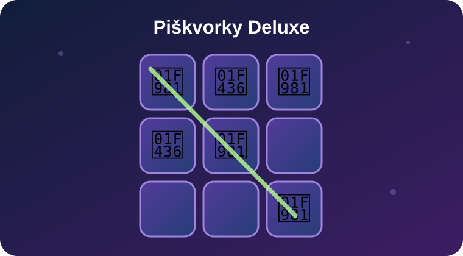

  

  
  

<h1 align="center">🎮 Tic-Tac-Toe Deluxe</h1>

  Touch-friendly tic-tac-toe for <strong>Scriptable</strong> on iPhone — against the computer or a friend.

  

  
  

## What it does

**Tic-Tac-Toe Deluxe** is an offline 3 × 3 game with touch controls, customizable player symbols and saved results.

## Key features

- 👥 Play against a friend or a computer with three difficulty settings.
- 🦁 Custom names, emoji and colors for both players.
- 🎨 Three themes and adjustable board size.
- 🔁 Alternate the starting player or choose a fixed starter.
- 🏆 Separate scores for AI and two-player modes, with a reset option.
- 🎉 Winning-line highlight, winner banner and confetti.
- 🔊 Optional sounds and saved settings.

  

## Getting started

1. Install **Piškvorky Deluxe** in Scriptable and open it.
2. Choose the computer opponent or local two-player mode.
3. Tap an empty square to make a move.
4. Open ⚙️ Settings to customize profiles, appearance, difficulty, sound and the starting player.

**Example:** Challenge the computer on Hard, or take turns with a friend on the same iPhone.

## Profiles and results

Change each player's name, emoji and color in Settings. Results are tracked separately for computer games and local two-player matches.

## Updates

The game checks for updates when it launches. You can see the installed version and last check status under ⚙️ Settings. An update is installed only with your approval, with a backup of the existing script created first. Offline gameplay is unaffected.

## Good to know

This is a full-screen Scriptable game, not a Home Screen widget. Game state and settings are stored locally. When iOS Reduce Motion is enabled, moving celebrations may be suppressed, but match results remain visible.

**Installation:** Open [Piskvorky Deluxe.scriptable](./Piskvorky%20Deluxe.scriptable) with Scriptable. If iOS shows it as plain text, download the [JavaScript file](./Piskvorky%20Deluxe.js) and save it under **iCloud Drive → Scriptable**.

## Origin and credits

The Deluxe edition expands a simple Scriptable tic-tac-toe example into a custom game with its own interface, AI, profiles and additional features.

## Links

  
  

## Support

  

   
  Scan the QR code or click the button.

