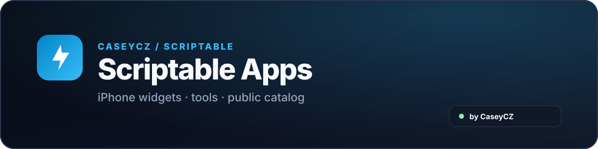
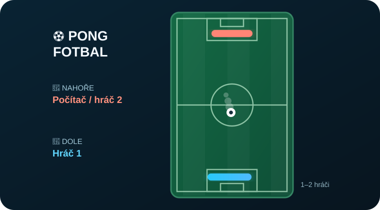

  

  
  

<h1 align="center">⚽ Pong Football</h1>

  Football-style Pong for <strong>Scriptable</strong> — portrait gameplay against AI or with two players.

  

  
  

## What it does

**Pong Football** is a fast arcade game with a ball and two paddles. Blue plays at the bottom, red at the top, and the goal is to outscore your opponent.

## Key features

- 🤖 Play against AI with Easy, Normal and Hard difficulty.
- 👥 Local two-player mode with simultaneous touch controls.
- 📱 Portrait pitch, with paddles moving horizontally at the top and bottom.
- ⚽ Matches to 3, 5 or 10 goals.
- 🏆 Win statistics and a confirmed reset option.
- 🌿 Stadium, Night and Classic pitch themes.
- 🔊 Optional sound, pause and update checking in Settings.

  

## Getting started

1. Install **Pong Fotbal** in Scriptable and launch it.
2. Choose AI or two-player mode and the target score in ⚙️ Settings.
3. Tap **Kick-off!** and drag horizontally in the bottom half to move the blue paddle.
4. In two-player mode, your opponent controls the red paddle from the top half of the screen.

**Example:** Play against AI in a first-to-five match, or share the screen with a friend and control one paddle each.

## Two-player controls

Each player uses their own half of the screen to move horizontally. On a keyboard, Blue uses **A/D** and Red uses **←/→**.

## Updates

Updates are checked automatically at launch. ⚙️ Settings shows the app version, check status and a **Check for updates** button. Available updates are offered when the game is launched again; the previous script is backed up before replacement. Playing offline is unaffected.

## Good to know

Matches can be paused at any time. Settings and results are stored locally; internet is only needed for update checks. This runs inside Scriptable and is not a Home Screen widget.

**Installation:** Open [Pong Fotbal.scriptable](./Pong%20Fotbal.scriptable) with Scriptable. If iOS shows it as plain text, download the [JavaScript file](./Pong%20Fotbal.js) and save it under **iCloud Drive → Scriptable**.

## Origin and credits

An original football-themed adaptation of classic Pong, designed for touch controls in portrait orientation.

## Links

  
  

## Support

  

   
  Scan the QR code or click the button.

