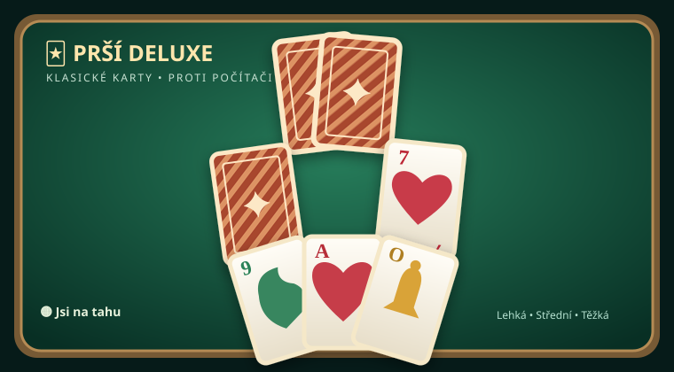

# 🃏 Prší Deluxe pro Scriptable

První samostatná verze klasického českého **Prší** na iPhone v aplikaci [Scriptable](https://apps.apple.com/app/scriptable/id1405459188). Hraješ **proti počítači**, bez registrace a bez připojení k internetu. Nejde o webovou verzi Číselné arény.

## Instalace do iPhonu

1. Stáhni [**Prsi Deluxe.scriptable**](./Prsi%20Deluxe.scriptable) a otevři jej v aplikaci Scriptable.
2. Pokud iOS soubor neimportuje, stáhni [**Prsi Deluxe.js**](./Prsi%20Deluxe.js), přesuň ho do **iCloud Drive → Scriptable** a spusť jej v aplikaci.
3. Hra se otevře na celý displej. Statistiky a rozehraná partie se při běžném zavření uloží lokálně do Keychain.

## Pravidla

- Balíček obsahuje **32 mariášových karet**: srdce, kule, zelené a žaludy, hodnoty 7 až eso.
- Každý hráč dostane **čtyři karty**. Pokládej stejnou barvu nebo hodnotu karty.
- **Sedmička:** soupeř si musí vzít dvě karty, nebo ji přebije další sedmičkou. Trest se sčítá.
- **Eso:** soupeř stojí, nebo ho přebije svým esem.
- **Svršek:** můžeš ho položit kdykoliv mimo nevyřešenou sedmičku či eso a vybrat novou barvu.
- Když nemáš vhodnou kartu, lízneš si jednu a končíš tah. Po dojití dobíracího balíčku se znovu zamíchají odhozené karty kromě vrchní.
- Vyhrává hráč, který jako první odhodí všechny karty.

## Funkce

- Tři obtížnosti počítače: lehká, střední, těžká.
- Zelený nebo modrý karetní stůl, jednoduché zvukové efekty.
- Karty v ruce se jen mírně překrývají a zůstávají plně neprůhledné. Pokud se jich nahromadí více, lze řadou vodorovně posouvat.
- Záznam tahů, přehled stavu výher a nová partie.
- Kontrola aktualizací v Nastavení a automatická kontrola při spuštění; nová verze se instaluje s potvrzením a zálohou původního skriptu.
- Samostatná implementace v JavaScriptu a HTML zobrazeném uvnitř Scriptable (`WebView`).

**Stav:** verze 0.1.1 pro test na iPhonu. Z verze 0.1.0 je potřeba tuto aktualizaci nainstalovat ručně; od verze 0.1.1 funguje kontrola dalších aktualizací přímo v aplikaci. Online hráči a integrace do Číselné arény zatím nejsou součástí hry.

Vzhled stolu a pravidla byly konzultovány podle veřejné hry [PršíGame.cz](https://www.prsigame.cz/play/) a [jejího návodu](https://www.prsigame.cz/blog/rules-of-prsi-how-to-play/). Kód a grafika jsou vlastní, nejedná se o kopii původní aplikace.
