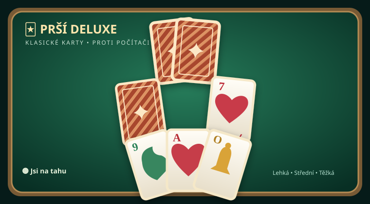

# 🃏 Prší Deluxe for Scriptable

The first standalone version of the traditional Czech card game **Prší**, built for [Scriptable](https://apps.apple.com/app/scriptable/id1405459188) on iPhone. Play **against the computer**, offline and without registration. This is not a Číselná aréna web game.

## Installation

Import [**Prsi Deluxe.scriptable**](./Prsi%20Deluxe.scriptable) into Scriptable. Alternatively, download [**Prsi Deluxe.js**](./Prsi%20Deluxe.js) into **iCloud Drive → Scriptable** and run it.

## Rules

- A 32-card German-suited deck (hearts, bells, leaves, acorns). Each player gets four cards.
- Match the last card's suit or rank.
- Seven: draw two cards, unless countered by another seven; the penalties stack.
- Ace: skip the next player's turn, unless countered by another ace.
- Upper jack (Ober): play on any non-pending card and choose a suit.
- If you cannot play, draw one card and end your turn. Discards are reshuffled when the stock runs out, keeping the top card.
- First to discard every card wins.

Three AI difficulties, two table themes, audio toggle, match history, and locally stored wins and current hand are included. Your cards have only slight overlap and remain fully opaque, with horizontal scrolling when the hand becomes crowded. Settings now include an update check, plus automatic update checks on launch and backup-before-replacement.

**Status:** v0.1.1, intended for on-device testing. Update manually from v0.1.0 once; later updates can be checked inside the app. No multiplayer or web integration yet.

This is an independent implementation inspired by [PršíGame.cz](https://www.prsigame.cz/play/) and its published [rules](https://www.prsigame.cz/blog/rules-of-prsi-how-to-play/), not copied source code.
